# chezmoi-tui

A keyboard-first terminal UI for inspecting and operating a `chezmoi` source
state without losing sight of what will change.



*Synthetic fixture generated by the repository screenshot example; it contains
no user data.*

The `0.3.1` release adds installation routes and fixes process-output capture.
It keeps the source tree, rendered target state, and actual destination
differences distinct so that each action can be reviewed in context. See
[the audit](docs/AUDIT.md) for evidence and known limitations.

Four visible tabs share a responsive List/Detail workspace, a compact Log drawer,
and a narrow single-pane mode. Refreshes publish progressively; previews use
debouncing and coalescing; marks survive filtering; and the action palette groups
37 inspection, editing, import, Git, and guarded mutation workflows.

## Interface

On wide terminals, List and Detail share the workspace while Log is a compact
drawer. Focus Log with `Tab` to use the configured Detail/Log split; `m`
maximizes or restores the focused pane. Narrower than 90 columns or shorter than
18 rows, the active focus becomes one pane while the header retains all four tabs.





## Installation

chezmoi-tui runs on Linux and macOS. On Windows, use the Linux route inside WSL;
native Windows is not supported. `chezmoi` is a separate prerequisite and must
be available through `PATH` or an explicit `--chezmoi`. The Homebrew formula
declares `chezmoi` as a runtime dependency, and the Nix flake wraps the TUI and
`chezmoi` together. All other routes require you to install `chezmoi`
separately.

The shortest global install uses mise's GitHub backend:

```bash
mise use -g github:tetsuya-dev-jp/chezmoi-tui@0.3.1
```

This uses mise's explicit GitHub backend; `chezmoi-tui` is not registered as a
plain mise registry entry. Other supported routes include:

<!-- markdownlint-disable MD013 -->
| Route | Install |
| --- | --- |
| Homebrew custom tap | `brew tap tetsuya-dev-jp/chezmoi-tui https://github.com/tetsuya-dev-jp/chezmoi-tui` then `brew install tetsuya-dev-jp/chezmoi-tui/chezmoi-tui` |
| cargo-binstall | `cargo binstall chezmoi-tui --version 0.3.1` |
| Cargo source build | `cargo install chezmoi-tui --version 0.3.1 --locked` |
| Nix flake | `nix profile install github:tetsuya-dev-jp/chezmoi-tui/v0.3.1` |
| asdf direct plugin URL | `asdf plugin add chezmoi-tui https://github.com/tetsuya-dev-jp/chezmoi-tui`, then `asdf install chezmoi-tui 0.3.1` and `asdf set -u chezmoi-tui 0.3.1` |
| Aqua custom registry | From a checkout, `AQUA_POLICY_CONFIG="$PWD/packaging/aqua-policy.yaml" aqua --config packaging/aqua.yaml install` |
| Linux distribution packages | Install the matching `.deb`, `.rpm`, `.pkg.tar.zst`, or `.apk` from the [v0.3.1 release](https://github.com/tetsuya-dev-jp/chezmoi-tui/releases/tag/v0.3.1) |
| Conda or Pixi | Install the matching local `.conda` file from the [v0.3.1 release](https://github.com/tetsuya-dev-jp/chezmoi-tui/releases/tag/v0.3.1) |
| Snap | Install the matching local `.snap` file from the [v0.3.1 release](https://github.com/tetsuya-dev-jp/chezmoi-tui/releases/tag/v0.3.1) |
<!-- markdownlint-enable MD013 -->

After downloading the x86_64 release assets, install them locally with:

```bash
sudo apt install ./chezmoi-tui_0.3.1_amd64.deb
sudo dnf install ./chezmoi-tui_0.3.1_x86_64.rpm
sudo yum install ./chezmoi-tui_0.3.1_x86_64.rpm
sudo zypper install ./chezmoi-tui_0.3.1_x86_64.rpm
sudo pacman -U ./chezmoi-tui_0.3.1_x86_64.pkg.tar.zst
sudo apk add --allow-untrusted ./chezmoi-tui_0.3.1_x86_64.apk

conda create -n chezmoi-tui ./chezmoi-tui-0.3.1-linux_64_0.conda
conda activate chezmoi-tui
pixi init
pixi add /absolute/path/to/chezmoi-tui-0.3.1-linux_64_0.conda
pixi run chezmoi-tui --version
sudo snap install --dangerous --classic ./chezmoi-tui_0.3.1_amd64.snap
```

These examples use x86_64 filenames. For aarch64, use `arm64` for Debian and
Snap, and `aarch64` for the other packages. The aarch64 Conda filename is
`chezmoi-tui-0.3.1-linux_aarch64_0.conda`.

The Homebrew tap is a repository-specific tap, not Homebrew core. The Nix
flake is in this repository, not nixpkgs. The Aqua package uses this
repository's custom registry, not Aqua's standard registry. Package assets are
local installs and are not published to an apt, dnf/yum, zypper, pacman, apk,
Conda, or Snap registry; no AUR package is provided. The local Snap must use
`--dangerous` because it is not signed through the Snap Store.

See [Installation](docs/INSTALLATION.md) for architecture choices, exact
commands, updates, uninstalls, release assets, and availability of other
managers. Rust `1.88` or newer is required only for source builds.

## Starting the TUI

```bash
chezmoi-tui
chezmoi-tui --view managed
chezmoi-tui --chezmoi /opt/chezmoi/bin/chezmoi
chezmoi-tui --chezmoi-config ~/.config/chezmoi/chezmoi.toml
chezmoi-tui --config ~/.config/chezmoi-tui/config.toml
```

`--config` selects chezmoi-tui's own TOML file. `--chezmoi-config` is passed to
every chezmoi invocation as chezmoi's `--config`. `--chezmoi` selects the
chezmoi binary. These are three distinct settings.

When `--destination` is omitted, the TUI asks chezmoi for the effective target
path and displays that destination. An explicit `--destination` remains an
override. `--source` and `--chezmoi-config` are forwarded to chezmoi
consistently.

## Views

<!-- markdownlint-disable MD013 -->
| View | Contents | Automatic detail |
| --- | --- | --- |
| Status | Differences reported by `chezmoi status` | Diff for the selected target |
| Managed | Managed target tree | Destination-file preview |
| Unmanaged | Files visible from the current working directory | Working-directory file preview |
| Source | Filtered raw source files under the effective source root | Raw source-file preview |
<!-- markdownlint-enable MD013 -->

Source is deliberately a **raw source tree**: it shows files and `.chezmoi*`
entries under the effective root, not decoded target state. With `.chezmoiroot`,
chezmoi-tui uses the root returned by `chezmoi source-path`.

Unmanaged can browse the current directory even when it is outside the session
destination. `add` and `add-directory` are disabled there. `ignore` remains
available only when the user explicitly selects the **Global by name** rule;
the TUI writes that rule to the active chezmoi source root and never invents a
destination-relative path for an outside target.

Managed and Status previews show destination bytes. To inspect the rendered
target state from templates and attributes, explicitly choose the `cat` action.
Merely navigating a list does not run `cat`, decrypt content, or persist output.

## Keyboard

| Key | Behavior |
| --- | --- |
| `1`–`4` | Switch Status, Managed, Unmanaged, Source |
| `Tab` / `BackTab` | Move focus forward or backward |
| `Ctrl+P` or `a` | Open the action menu |
| `r` / `?` / `!` | Refresh / help / notice history |
| `m` | Maximize/restore the focused pane |
| `q` / `Ctrl+C` | Quit when no mutation or batch is active |

List focus:

| Key | Behavior |
| --- | --- |
| `j` / `k`, arrows | Move selection |
| `Home` / `End`, `g` / `G` | First or last item |
| `PgUp` / `PgDn` | Move by a page |
| `Enter` | Expand a directory or open its diff/preview |
| `h` / `l`, arrows | Collapse or expand a tree item |
| `/` | Filter the list |
| `Space` / `c` | Toggle a mark / clear all marks |
| `d` / `v` | Load diff / file preview where available |
| `e` | Edit the selected managed file |

Detail or Log focus:

| Key | Behavior |
| --- | --- |
| `j` / `k`, arrows | Scroll |
| `PgUp` / `PgDn`, `Ctrl+U` / `Ctrl+D` | Larger scroll |
| `H` / `L` | Horizontal scroll |
| `/` | Search the focused pane |
| `n` / `N` | Next/previous match or diff hunk |

## Actions

The `0.3.0` action set contains 37 actions. The menu groups entries by scope and
keeps dangerous actions behind explicit `danger:<name>` filtering. The
workflow groups are:

- **Inspect and diagnose:** `doctor`, `data`, `debug-context`, `verify`, `cat`,
  `ignored`, `dump-config`, `diff-all`, `external-diff`.
- **Change and import:** `apply`, `add`, `preview-add-directory`,
  `add-directory`, `ignore`, `chattr`, `re-add`, `re-add-all`, `forget`, `init`.
- **Edit and configure:** `edit`, `edit-source`, `edit-config`,
  `edit-config-template`, `edit-ignore`, `open-source-dir`.
- **Update and source Git:** `update`, `git-status`, `git-diff`, `git-log`,
  `git-stage`, `git-commit`, `git-push`, `git-pull`, `merge`, `merge-all`.
- **Exceptional destruction:** `destroy`, `purge`.

`preview-add-directory` runs recursive `add --dry-run --verbose`;
`add-directory` runs confirmed recursive `add`. This implementation does not
add `--exact` or `--follow`. `git-pull` updates the source without applying;
`git-push` pushes existing commits; `git-commit` commits staged changes;
`git-stage` stages the selected source file.

Aggregate Apply uses one reviewed plan and one confirmation for the selected
target set. Accepting it starts a single serialized mutation job that
revalidates the current snapshot immediately before applying, with no window
for another mutation to interleave between validation and apply.

Managed directories are valid targets. The plan includes their complete
recursive descendant set and directory diffs use `chezmoi diff --recursive`.

The new inspection actions are read-only. `cat` and `dump-config` do not open
an extra confirmation modal: choosing them from the action palette is the
explicit intent. Their result can still be sensitive and is displayed locally.

## Refresh and preview behavior

- Status, Managed, Unmanaged, Source, and ignore data are published to the UI
  independently as each result completes. One slow view does not hide a result
  that is already ready.
- Repeated refresh requests are coalesced, mutations are serialized, and detail
  requests keep IDs so obsolete responses cannot replace the current selection.
- Automatic diff/preview loading is debounced. Queued detail work coalesces to
  the newest request.
- Unmanaged list search is incremental and time-budgeted rather than running an
  unbounded recursive scan on every keystroke.
- Marks are stored as selected paths and remain part of the batch set when a
  filter hides their rows.
- Commands have a timeout and bounded stdout/stderr. File preview rejects
  FIFOs/devices, binary input, and bounds text reads.

## Safety model

- `destroy` requires the exact typed phrase `DESTROY <target>`;
  `purge` requires `PURGE ALL`.
- Setting `safety.require_two_step_confirmation = false` does not disable those
  typed phrases.
- `apply` can use an Apply Plan, and broad mutations open a preflight review.
- Focused mutations and tools that need a terminal run through foreground
  handoff. Noninteractive subprocesses use null stdin.
- Add and recursive directory add are rejected outside the resolved
  destination.
- Ignore outside the destination permits only the explicit Global by name rule.

## Configuration

chezmoi-tui reads its own TOML file from `dirs::config_dir()`:

- Linux: `~/.config/chezmoi-tui/config.toml`
- macOS: `~/Library/Application Support/chezmoi-tui/config.toml`

The file is optional. An explicitly supplied `--config` path that does not
exist is an error. Unknown fields are rejected so misspelled settings do not
silently fall back.

```toml
[ui]
default_view = "status"
auto_preview = true
list_ratio = 35
detail_ratio = 65
footer_help = false

[safety]
require_two_step_confirmation = true
show_apply_plan = true

[tools]
editor = "nvim"
external_diff = "delta"
```

`list_ratio` sets the wide List/right-column split. `detail_ratio` is used when
Log is focused; while another pane is focused, Log stays in its four-row
drawer. `footer_help` adds the extra keyboard sheet. Ratios accept 10–90.

`tools.editor` and `tools.external_diff` are split into a program and arguments.
Quoted words are supported, invalid quoting is rejected, and values are not
passed through a shell.

CLI flags override file values. `--no-config` skips the TUI config file;
`--no-auto-preview` disables automatic detail loading.

## Known limitations

- Path-bearing machine output must be UTF-8. Managed names containing LF or CR
  are also unsupported by the newline-based status format and fail closed before
  status parsing, preventing an embedded line from aliasing as another row.
- Key generation, encryption, decryption, custom secret-manager configuration,
  archive import, containers, SSH, upgrades, and other advanced operations stay
  in the foreground chezmoi shell handoff. The TUI does not implement a second
  security or secret-management stack.
- The final paired synthetic run reduced first-status median from about 204.5 ms
  to 36.47 ms, roughly 82.17% or 5.61x. First-frame medians stayed near 3.54 ms,
  and no large-`.git`-specific benefit is demonstrated. See
  [the performance method](docs/PERFORMANCE.md).

## Verification and distribution

The application retains the `0.3.0` configuration, CLI, and public Rust API.
Output capture uses positional reads so a terminating descendant cannot move
the reader's cursor or have its output overwritten. On a tagged release,
the workflow builds six archives and derives eight
distribution packages, two Conda packages, and two Snap packages from the
static musl binaries. It validates package metadata and paths, publishes the
crate, and creates a draft GitHub release. It also checks the architecture of
the macOS aarch64 cross-build; macOS ARM runtime execution is not tested by CI.
Package-install smoke tests are configured on native Linux x86_64 and aarch64
runners; the Arch package-install check is x86_64-only.
Snap metadata, filesystem contents, and the native executable are required
checks. Full Snap daemon installation is advisory because hosted runners have
encountered Snap Store HTTP 408 and EOF errors while fetching prerequisites.

The release asset set includes GNU and musl archives for Linux x86_64 and
aarch64 plus archives for macOS x86_64 and aarch64. The `.deb`, `.rpm`,
`.pkg.tar.zst`, `.apk`, `.conda`, and `.snap` files are local release assets
for both Linux architectures. Publication does not register them with a
distribution repository, conda-forge, or the Snap Store.

## License

MIT. See [LICENSE](LICENSE).
